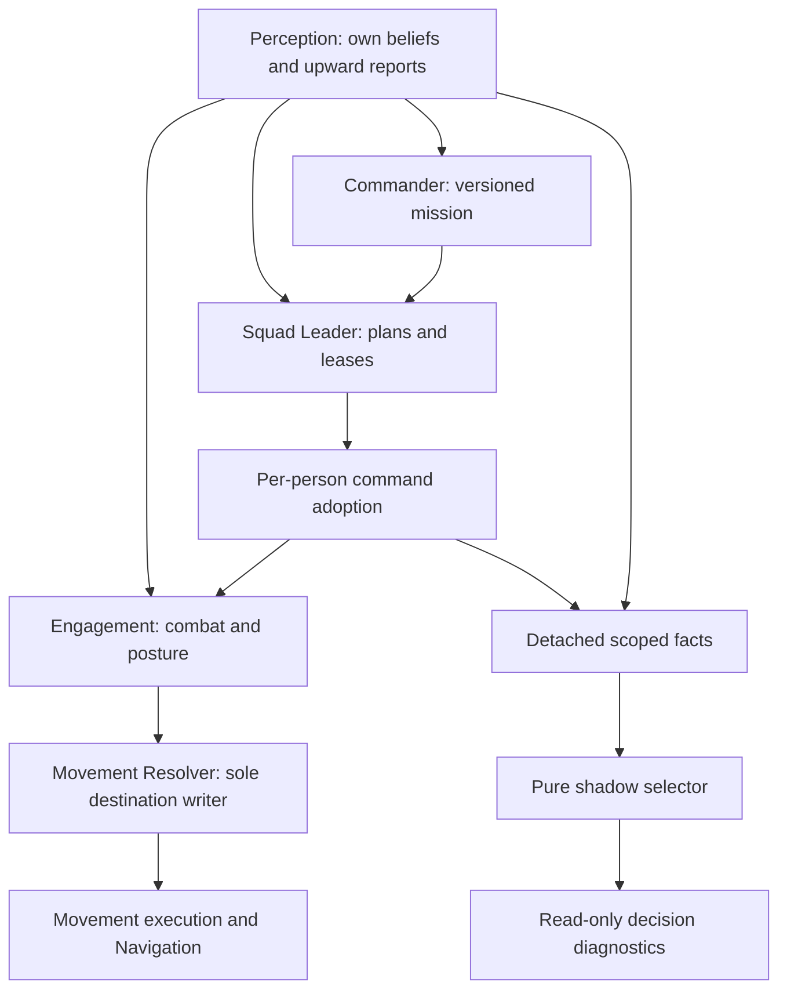

# AI Skills V1 contract (#602)

Status: foundation only; gameplay remains legacy. PR A defines contracts; PR B may
compute shadow decisions. Pilot execution (C), Phase C migration (D) and retirement
(E) require further authorization. No merge is authorized by #602.

## Verified baseline and dependency graph

Inspected `main@eba6c71f2596fca9cc02d39911205468317d1a83` on 2026-10-21,
including #605–#610; not the older audit SHA. #610's head
`3b889a916ed78522899a1fc2ff954535efcdab47` passed CI run
[39532721817](https://github.com/APPARANYX/grasstex/actions/runs/39532721817).
Merged main deployed in run
[39533047685](https://github.com/APPARANYX/grasstex/actions/runs/39533047685).
That is historical PR/deployment evidence, not final combined integration acceptance;
[the acceptance register](../audits/ARCHITECTURE_STABILIZATION_V1_20261020.md)
remains open.

Open work inspected: #584 changes ideation QA; #499 changes the reported-contact
map/camera; #299 is the old campaign draft; #527 is the parked Phase C draft
(head `dc56795756441ca2b8d6ad5f1f86018872f5fd06`, 34 changed files including
Engagement, Meso, reception and resolver). None is a dependency or merge source.
#418 and #438 remain independent deferred work.

Both PHP entries load core in this order: core-runtime, soldier, weapons,
obstacle-field, terrain-features, squad-ai, movement-resolver, engagement,
battle-sim. Extra runtimes follow: camera-controls, acoustics, scenario-generator,
battle-navigation, town-objectives, module-registry, ai-policy, objective-system,
battle-telemetry, commander-doctrine, commander-routes, commander-ai. Modules are
then discovered and sorted by filename (`SORT_STRING`), filtered by the shared
`runtime-contract.php`; ai-trainer and battle-control follow. Module factories
15a–15o are attached by 16. A skills module must load after its readers, register
one system, and never wrap start/restart/updateSoldier.



## Scopes, facts and skill API

Scores compare only within one actor's scope: `soldier`, `squad`, or `command`.
A soldier sees own beliefs and personally received commands; a squad sees reported
member intel and its accepted mission; command sees upward reports only. Access
to a faction roster is permitted solely to enumerate own actors, never to inspect
hostile actors. No skill receives the sim, entities, enemy references, RNG or APIs.

A fact is a detached immutable record `{source, observedAt, expiresAt, confidence,
generation, location, key}`. `observedAt <= now < expiresAt`, finite coordinates,
confidence in (0,1], and current generation are mandatory. Do not refresh old intel
when copying it. No enemy unit/transform/weapon reference survives projection.
Use `SquadAI.beliefSnapshot` for personal facts (not `soldierContact`, whose
selection cache can mutate). Use `BattleCommandReception.peek` for receipt state;
`snapshot`, `adopted` and `adoptedView` call `settle` and are unsuitable for a
neutral observer. Missing/legacy provenance is denied, not promoted to knowledge.
Squad/command adapters need separately proven upward-report provenance; V1 shadow
may leave those scopes unsupported rather than invent facts.

Plain JS contract (no build tooling):

```js
registerSkill({
  id: 'soldier.seek-cover', scope: 'soldier',
  requires: ['perceived-threat', 'reachable-cover'],
  resources: ['locomotion', 'posture'],
  parameters: { threshold: { type: 'number', min: 0, max: 1, default: 0.5 } },
  evaluate: (snapshot, parameters) => ({
    eligible: true, score: 0.8, reason: 'exposed-to-known-fire', evidence: []
  }),
  createPlan: (snapshot, actions) => actions.sequence(/* authorized actions */)
});
```

IDs are unique, ordered by ASCII comparison, scopes/resources/capabilities and
parameters validated at registration/config resolution. Registration never evaluates
or creates a plan. Evaluation gets one shared snapshot per actor/Commander tick;
it returns finite [0,1] utility and bounded reason/evidence. Highest score wins;
exact ties choose the smaller ID. No cross-scope ranking. Mission, ROE, safety,
receipt, freshness and resource availability are hard guards before evaluation.
Missing guards deny eligibility regardless of score. Required capabilities must
be facts established by their owners, not asserted by the skill.

## Permissions and existing candidates

| Candidate / resource | Existing decision vs executor | Permission and smallest adapter |
| --- | --- | --- |
| soldier seek-cover / locomotion, posture | Engagement decides; module 19 `findCover`, `boundRoute`, `reserveCover` execute/claim | `findCover` is not pure: it can reserve and report. Shadow only observes threat, never calls it. Future Engagement action adapter must preserve cover ownership. |
| soldier hold/fire / posture, weapon | Engagement state/drill/`supportReady`; 19b fire/stance | No direct stance/trigger write. A requested action needs Engagement receipt and current adopted ROE. |
| squad covered bound / team, locomotion | 15n `localPlan` scores choices; 15j `fireAndMovement` commits/publishes; 15o prepares firing posts | Local-plan scoring and skill utility overlap as decisions; they cannot both select. Keep existing executors; later replace one scoped decision only after pilot gates. |
| squad regroup / team | 15m cohesion/regroup and 16 lease/anchor publication | Reuse Meso command publisher and BattleLeases, not another timer/anchor/destination. |
| command objective / orders | Commander `reconsiderMission`/`issueMission`; doctrine/routes | Command-only intent, no squad phase/route rewrite. No command skill in first shadow release. |
| transport / team, locomotion | module 58 owns mission journey/seat/exit lifecycle | Owner request/receipt only; never write seats, carrier, position or passenger state. |
| report / communications | SquadAI beliefs, module 09 delivery | Submit through provenance-preserving communications owner, never grant a sighting. |
| move/hold execution | resolver `proposeOrder`/`proposeCombat`, Navigation routes; 18a `man`/`squad` outcome | Existing priorities/TTL/hysteresis remain authoritative. Proposed point is not arrival; use physical outcome tied to envelope and mission. |

Likewise-named functions do not imply duplicate authority: Navigation reachability,
Engagement eligibility and Meso tactical choice answer different questions. Broad
closure factories are an adapter constraint, not permission to export mutable ctx.
No new resolver priority, lease type, global state mirror or navigation algorithm.

## Lifecycle, scheduling and rollback

Use `BattleModules.registerSystem` with `onBattleStart`, `beforeBattleRestart`,
`onBattleRestart`, and `onCommanderTick`. Core restart remains
request → before → roster replacement → afterRosterReset (Commander emits nested
onBattleRestart) → afterRestart → complete. Keep private per-sim WeakMap state;
never stamp authoritative actors. A generation token changes at each start/restart;
state identity also includes entity and Macro mission version. Drop old state
before roster replacement, handle multiple independent sims, and reject old snapshots.
Commander cadence is 0.45 simulated seconds after 0.15-s AI ticks, not render time.
Deterministic ID ordering, fixed operation budgets and no wall clocks/RNG.

Future C has one scheduler for resource acquisition, commitment, suspension,
preemption, timeout and release. It must integrate existing BattleLeases and personal
adoption, not duplicate their commitments. The action lifecycle is
`not-started → running → succeeded|failed|cancelled`; BT nodes return
`Success|Running|Failure` with receipts and bounded typed reasons:
`invalid-target`, `stale-intel`, `blocked-route`, `never-arrived`,
`unsupported-action`, `no-authority`, `interrupted`. Death/safety, mission supersession
and restart preempt utility. B acquires no resources and runs no BT, even if a
factory is registered. C's exact lease/effector adapter remains a review gate.

One validated profile controls mode `legacy|shadow|pilot` and per-skill enablement
and typed parameters. Default is legacy. B rejects pilot. One `aiSkills` query may
select legacy/shadow; no per-skill query parsers. Explicit disable overrides a
registered skill. Invalid/unknown config fails closed with a diagnostic. Changing
profile clears shadow receipts; C must cancel/release/reconcile before falling back.
Rollback B by selecting legacy; it prepares no facts/evaluations/plans and issues
no actions. A has no runtime load changes.

Decision receipts contain entity, scope, generation, mission version, skill, score,
chosen/rejected reasons, blockers, action (`none` in shadow), owner and outcome.
A bounded private ring returns frozen detached views. Observer-off disables only
recording: it must not alter selection, gameplay, command history or RNG. Diagnostic
reads never prepare snapshots, advance adoption or extend fact validity.

## Executable gates and reproducible conditions

`node tools/ai-sim-harness/ai-skills-contract-check.js` exercises the shipping pure
belief/receipt readers with hostile-reference traps and pending adoption; it also
checks lifecycle/loader contracts. Baseline and every final head run:

```sh
for c in tools/ai-sim-harness/*-check.js; do node "$c" || exit 1; done
for s in 12345 1 2 3 5 8 13 21; do HARNESS_SEED=$s node tools/ai-sim-harness/run.js || exit 1; done
node tools/ai-sim-harness/state-ownership-check.js
node tools/ai-sim-harness/wire-map-check.js
node tools/ai-sim-harness/squad-phase-check.js
```

Full CI additionally owns syntax/formatting and `scripts/check-*.cjs` gates. Record
actual results in PRs. PHP is needed by loader/preview checks. Do not waive failures.
Baseline seed suite deliberately isolates Engagement: run.js uses
`morale=0&coa=0&stressAct=0&fireControl=0&stanceVis=0&slStress=0&soldierBeliefs=0&incomingFireReveal=0&leaderlessIntent=0`;
it does not prove complete runtime parity.

For runtime B, use the existing GitHub standard paired benchmark, never local
fingerprint batches. Seed `ai-skills-v1-602`, one exact-seed pair per meeting,
us-defend and ge-defend, 600 actual simulated seconds, 0.15 fixed step/0.45 Commander;
legacy/shadow must have identical gameplay records/outcomes/command history.
Repeat with observer disabled and profile disabled. Preserve head, effective flags,
scenario and clock in artifacts; measure shadow cost, make no performance claim.

Full-ON 5 km control explicitly sets
`strategicInterception=1&frontLines=1&motorTransport=1&truckAccess=1&truckCollision=1&truckVisual=1&aerialRecon=1&interception=1&reinforcements=1&reinforcementSortie=1`,
normal map, Combat Lab off. All ten are currently default-on in core-runtime.
Do not call `probe_strategic_5km.cjs` full-ON: its control explicitly has
`frontLines=0`, seed `strategic-chromium-0001`. Browser QA uses the immutable branch
preview with effective configuration asserted, and repeated same-page restarts.

Phase C diagnostic controls remain opt-in:
`localPlan=1&localAmbush=1&localManeuver=1&coveredBounds=1`, existing
`probe_phase_c_natural.cjs` seed prefix `phase-c-natural-20261012`, 3 seeds ×
meeting/us-defend/ge-defend, 210 simulated seconds (not full acceptance). Separate
resource/task/degradation options require explicit recording, never implied ON.
Future acceptance needs the real same-squad/plan chain through two independently
effective supporters and actual covered arrival; a staged fixture cannot accept C.
No navigation/ballistics/weapon/movement or Phase C changes in A/B.

## PR B adapter and file boundary

`battle/modules/60-ai-skills.js` is the only runtime addition: registry, profile
resolver, personal fact projection, pure selector and one registered shadow system.
`runtime-contract.php` only forwards the single `aiSkills` preview option; it does
not interpret it. `tools/ai-sim-harness/ai-skills-shadow-check.js` exercises the
negative/neutrality/budget contracts. `scripts/probes/probe_ai_skills_shadow.cjs`
and `.github/workflows/ai-skills-shadow-qa.yml` exercise the immutable hosted preview,
three same-page restarts, owner-read neutrality, full-ON configuration and rollback.
These are the precise B changes; no AI owner file changes or wire-map exemptions.

The built-in `soldier.observe-threat` is a diagnostic candidate with no resources,
no actions and no plan; it scores the maximum valid perceived confidence against
a typed threshold. New registered skills default disabled; the one initial central
profile enables only this diagnostic candidate, with mode still legacy. Configure
via `BattleAISkills.configure({mode:'shadow', skills:{'soldier.observe-threat':
{enabled:true, parameters:{threshold:0.25}}}})`; `observer:false` disables recording.
Invalid profiles return legacy and `diagnostics().error = 'invalid-profile'`.
All other skills require explicit manifest entries. Registry supports all three
scope declarations, but automatic B snapshots deliberately support soldiers only.
Reachable-cover and action resources remain unavailable; B does not call mutating
owner readers to invent availability. Evaluator modules are trusted code, not a
JavaScript security sandbox; the runtime supplies no world/action references.

Limits are 32 registered skills, 512 actors per Commander decision, 32 personal
belief rows and a 128-row receipt ring per battle. Overflow is explicit (omitted
actors or `guard-budget`); no wall-time scheduling or unbounded retries. Counters
separate prepared snapshots from actual evaluator invocations. These are operation
bounds, not measured p95/p99 CPU claims. C still needs the reviewed shared resource
and effector adapters before any claimed resource can be acquired or action run.
