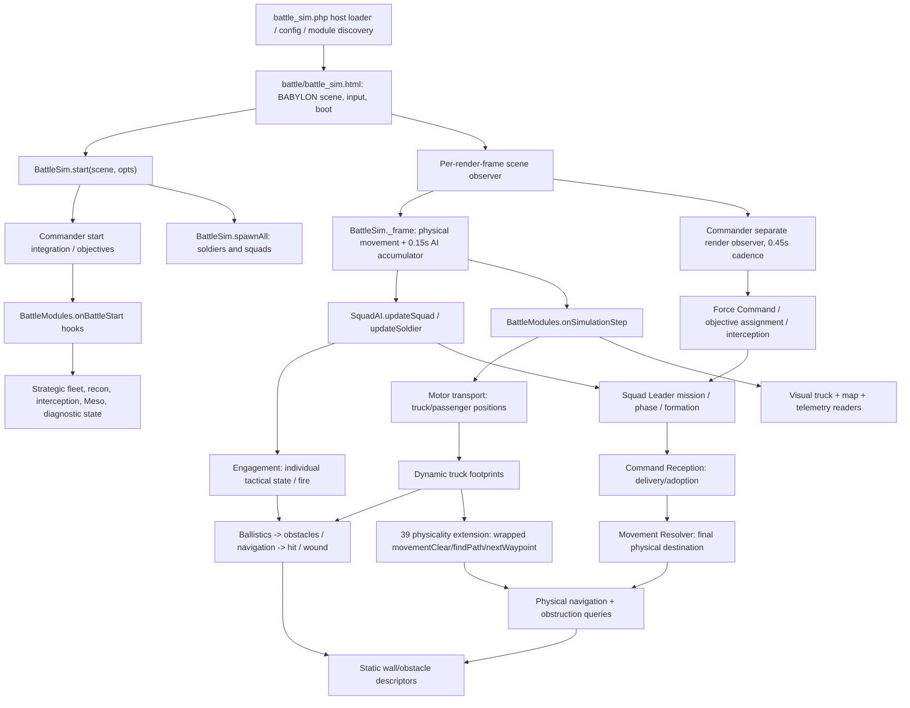

# Runtime architecture, ownership, and state-machine inventory

Baseline: [`f89939f2f6e8ff21063d1b24c28a8ab73fe9d2e9`](https://github.com/APPARANYX/grasstex/commit/f89939f2f6e8ff21063d1b24c28a8ab73fe9d2e9). The graph below is reconstructed from source; dependency edges are implementation-observed unless labeled conceptual.

## Execution / dependency map

**Source:** [HTML startup](https://github.com/APPARANYX/grasstex/blob/f89939f2f6e8ff21063d1b24c28a8ab73fe9d2e9/battle/battle_sim.html#L94-L106), [BattleSim creation](https://github.com/APPARANYX/grasstex/blob/f89939f2f6e8ff21063d1b24c28a8ab73fe9d2e9/battle/battle-sim.js#L357-L384), [frame/AI scheduling](https://github.com/APPARANYX/grasstex/blob/f89939f2f6e8ff21063d1b24c28a8ab73fe9d2e9/battle/battle-sim.js#L859-L897), [commander start/restart/tick](https://github.com/APPARANYX/grasstex/blob/f89939f2f6e8ff21063d1b24c28a8ab73fe9d2e9/battle/commander-ai.js#L737-L811), [hook dispatch](https://github.com/APPARANYX/grasstex/blob/f89939f2f6e8ff21063d1b24c28a8ab73fe9d2e9/battle/module-registry.js#L115-L142).

### Responsibility and mutation-boundary matrix

| Subsystem | Primary owner | Mutations / externally visible contracts | Boundary quality |
| --- | --- | --- | --- |
| Battle lifecycle/time | `battle/battle-sim.js` | `time`, `paused`, `winner`, roster, `_frame`; extended by commander/operator/clock wrappers | **Fragmented** |
| Scenario/world | `battle/scenario-generator.js`, `terrain-features.js`, `town-objectives.js` | seeded scenario, scenario metadata, terrain objects | Mostly explicit, server and local boot differ |
| Macro commander | `battle/commander-ai.js`, `commander-doctrine.js`, `commander-routes.js` | mission issuance, commander tick, objective plan | Explicit intended M3C separation; start monkey-patching |
| Strategic ISR/interception | `59-strategic-aerial-recon.js`, `59b-strategic-interception.js` | bounded recon DTO and candidate proposals to command | Evidence of care to limit hostile truth reads, needs negative tests |
| Squad leader | `16-squad-plan-stability.js`, `15a`–`15o` helpers | `commandPhase`, plans, formation assignments, personal order proposals | Central integration file too broad; helpers share implicit context |
| Command reception | `18-command-reception.js` | envelopes, per-recipient adoption / acknowledgement | Dedicated lifecycle with time-indexed settle |
| Soldier combat | `squad-ai.js`, `engagement.js`, `17-soldier-mind.js` | perception, engagement state, injuries, combat movement proposals | Meaningful owners; soldier fields cross many extensions |
| Movement arbitration | `movement-resolver.js` | final soldier `destination`, precedence and hysteresis | Good authority, but physical corrections in `battle-sim.js` |
| Navigation/geometry | `battle-navigation.js`, `obstacle-field.js`, `14-z-ballistic-raycast.js` | static wall paths and LOS, obstacle/ballistic footprints | Layered static + physicality wrappers; no missing effective public collision proved |
| Vehicle lifecycle | `58-strategic-abstract-transport.js` | fleet registry and per-squad task, passengers and collision footprints | One file, several overlapping state views |
| Animation/rendering | `52`–`53` FBX/LOD modules; `59-strategic-truck-visual.js` | meshes, cached rigs, visual vehicle updates | Visual-only truck contract is correct direction |
| UI/diagnostics | `camera-controls.js`, `55-reported-contact-tactical-map.js`, `36-order-provenance.js`, `99-session-diagnostics-export.js` | read models plus some method instrumentation | Read/write observability separation needs stronger tests |
| Server/deployment | `battle_sim.php`, `preview.php`, `battle_*.php`, `wargame/api.php`, Actions workflows | content origin, staging, saved state, runtime flags | Preview and POST boundaries differ |

### Initialization and update order

1. Host chooses/deploys a resolved GitHub ref, chooses module files, performs HTML template/script substitution; fallback may load `battle_sim_local.php`.
2. Page constructs scenario, scene, terrain, camera, soldiers; `BattleSim.start` is actually a chain of `start` wrappers (core → commander → fixed-clock → animation-events → optional damage-range → session diagnostics → operator-control). This order is **fragile and documented**.
3. Commander setup attaches objectives, initializes forces, calls `onBattleStart`; strategic and other modules reset through lexicographically sorted registry IDs.
4. Every render frame the normal path executes movement, accumulated 0.15-s AI ticks, then `onSimulationStep` hooks, while a separate observer accumulates 0.45-s commander decision ticks. The optional fixed-clock observer changes that schedule.
5. Death/finish invokes casualty and winner side effects; restart is nested core-restart plus commander/operator/fixed-clock wrappers, registry teardown and reinitialization.
6. Diagnostics and bench probes read/record this state; PHP endpoints may persist external policy/learning records independent of stashed client genome.

**Important:** `runHook` catches all registered hook exceptions, logs, and continues. A partially failed restart is therefore not necessarily promoted into a test failure. [Hook source](https://github.com/APPARANYX/grasstex/blob/f89939f2f6e8ff21063d1b24c28a8ab73fe9d2e9/battle/module-registry.js#L131-L140).

### Circular and hidden dependencies

- `squad-ai` ↔ `engagement` ↔ resolver/navigation are interconnected via `window/root` globals and `extend` hooks rather than explicit imports; circular module ownership is a runtime **conceptual cycle**, not a proven ES-module import cycle.
- `commander-ai` issues briefs that transport interprets; transport writes squad and vehicle state and then squad autonomous movement must resume, crossing Macro/Meso/Micro boundaries.
- `36-order-provenance.js` instruments module hook functions and `BattleEngagement.updateSoldier` at runtime. Observability depends on installed wrapper order rather than an explicit event source.
- Navigation's module-scope `scenario`, `walls`, `nodes` cache [lines 13-20](https://github.com/APPARANYX/grasstex/blob/f89939f2f6e8ff21063d1b24c28a8ab73fe9d2e9/battle/battle-navigation.js#L13-L20) potentially prevents two worlds from being tested concurrently in one JS realm; cross-world run not verified.
- `BattleSim.start`, `sim.restart`, `onBeforeRenderObservable` and `onSimulationStep` together define lifecycle/timing implicitly rather than one auditable application root.

## State machines: existing states and proposed invariants

| System | Observed source-level states / orthogonal properties | Authority | Required invariants & simplification |
| --- | --- | --- | --- |
| Battle | paused/running, winner, manualEnded, winReason, timeLimit, fixed-clock debt, telemetry status | Core + commander + operator + clock | Terminal cannot advance without explicit Continue or new generation; restart clears *all* per-generation effects. One lifecycle aggregate, orthogonal clock mode and UI state. |
| Macro mission | owner, intent, issued/executing status, version, objective, route; interception stages | Force Command and doctrine | Mission versions monotonic per scope; stale missions cannot mutate units; proposals never themselves move soldiers. Keep strategic intents separate from tactical execution. |
| Squad | `sq.state` (e.g. advance/retreat), `commandPhase` 11 labels, `_engagementPlan`, role, leases, contact | Meso Squad Leader + engagement facts | Only one owner each of mission phase, tactical plan and combat status; interruptions do not destroy resumable mission intent. |
| Soldier | engagement state and stance, mind stress reactions, movement intent, target, fire gate, death | Engagement / Mind / Resolver | Dead entities cannot act, reserve, fire or board; animation is derived from authoritative combat/motion state. |
| Command reception | envelope ID/version, in-flight/delivered/adopted, per-recipient stage, scope, retry | Command Reception | Personal adoption precedes execution where required; no cross-squad leakage; stale envelopes cannot reactivate superseded movement. |
| Transport | vehicle parked/assigned/moving/disembarking/stopped + squad boarding/embarked/disembarking/dismounted/aborted; seat lists and counts | Abstract Transport | Exactly zero/one owner per vehicle, at most one seat per living passenger, no leaked reservation, terminal release, continuous body position on resume. |
| Objective | owner neutral/us/ge, active faction, pressure progress, phase idle/held/capturing/neutralizing | Objective System + capture-zone type | Owning a zone is not the same as active pressure; progress does not switch side without reset; phase may be derived from owner/pressure. |
| Recon | sightings, bounded report, confidence, age, corridor opportunity, issued intercept brief | Aerial Recon + General | General accesses report DTO, not hidden actor transforms; expired intel cannot be treated as current truth. |
| Navigation | route/waypoint, cache, blocked/replan hold, tactical move intents | Resolver + physical navigation | Public movement checks go through physicality's wrapped `movementClear` and dynamically registered footprints when enabled; routing also uses the physical planner. Assert parity of effective queries, not just the base module's local calls. |
| Diagnostics | active session, timeline/provenance, counters and downloadable read views | Multiple observer modules | Observers do not change gameplay output; error paths cannot silently report success. |

### Highest-risk transition tables

**Transport** (reconstructed from [owner file](https://github.com/APPARANYX/grasstex/blob/f89939f2f6e8ff21063d1b24c28a8ab73fe9d2e9/battle/modules/58-strategic-abstract-transport.js)):

| From | Event/guard | To | Required side effects |
| --- | --- | --- | --- |
| parked/stopped vehicle | qualified Macro mission + unreserved vehicle | vehicle assigned / squad boarding | bind vehicle→squad and squad→vehicle once, select seats |
| boarding | each eligible actor physically reaches seat | boarding (increment seat occupancy) | synchronize seated IDs, count, pose |
| boarding | all seats occupied | embarked | begin travel at actual pickup location |
| boarding/embarked | contact/death/retreat/version change/timeout/blocked route | disembarking, or aborted if none aboard | hold truck at physical location, preserve survivor movement |
| embarked | reach road turnout | disembarking or dismounted | release passengers without teleport |
| disembarking | door free and next passenger seated | disembarking (next cursor) | vacate exactly one seat |
| disembarking | all exits complete and positions staged | dismounted or aborted | release fleet reservation, restore movement |
| **disembarking** | **door continuously occupied** | **disembarking indefinitely** | **Missing liveness/terminal escalation path**; requires deterministic counterexample |

**Squad command phase:** 11 labels `approach,reserve,hold,support-hold,corner-check,assault,capture,defend,flank,clear-town,regroup`; **each declares all 11 phases as permissible next states**, by design to permit new mission preemption. This is a descriptive label + external guards, not a strict FSM. [Phase definition](https://github.com/APPARANYX/grasstex/blob/f89939f2f6e8ff21063d1b24c28a8ab73fe9d2e9/battle/modules/16-squad-plan-stability.js#L842-L935). Before removing phase labels, establish which inform movement, UI, lease, or outcome checks.

**Objective:** neutral/owned × active/no active × progress progressBy + phase. `phase` appears derivable from ownership and pressure; check timing nuance before removal. [Capture tick](https://github.com/APPARANYX/grasstex/blob/f89939f2f6e8ff21063d1b24c28a8ab73fe9d2e9/battle/modules/01-capture-zone.js#L96-L194).

### Simplification direction

Keep genuinely orthogonal states (combat posture vs mission progress), but **eliminate competing writers and redundant materializations**. Use one battle-generation lifecycle event stream and deterministic step coordinator; one mission-versioned command boundary; one canonical vehicle occupancy ledger with derived squad-facing status; a verified physicality/geometry contract and validated feature-profile/config contract. Do not convert everything to an overbuilt generalized FSM framework.

### PHYSICALITY CORRECTION (final source cross-check)

The base module's [`movementClear(a,b)`](https://github.com/APPARANYX/grasstex/blob/f89939f2f6e8ff21063d1b24c28a8ab73fe9d2e9/battle/battle-navigation.js#L107-L129) indeed handles only static wall geometry. **However,** the shipping [`39-navigation-physicality-debug.js:871–906`](https://github.com/APPARANYX/grasstex/blob/f89939f2f6e8ff21063d1b24c28a8ab73fe9d2e9/battle/modules/39-navigation-physicality-debug.js#L871-L906) captures the base function, replaces exported `N.movementClear(a,b,options)` with the dynamic-volume check (including `ignoreDynamicId`), **and replaces `N.findPath` and `N.nextWaypoint` with physical routing**. [`gatherStatic:198–210`](https://github.com/APPARANYX/grasstex/blob/f89939f2f6e8ff21063d1b24c28a8ab73fe9d2e9/battle/modules/39-navigation-physicality-debug.js#L198-L210) merges dynamic footprints. Therefore an earlier inference that effective runtime movement ignores trucks is **incorrect**. What remains is architecture debt: the correctness of collision depends on the load-time wrapper, the URL flag, module-scope `simRef`, and different geometry owners. Test the *composed* runtime before proposing consolidation.
