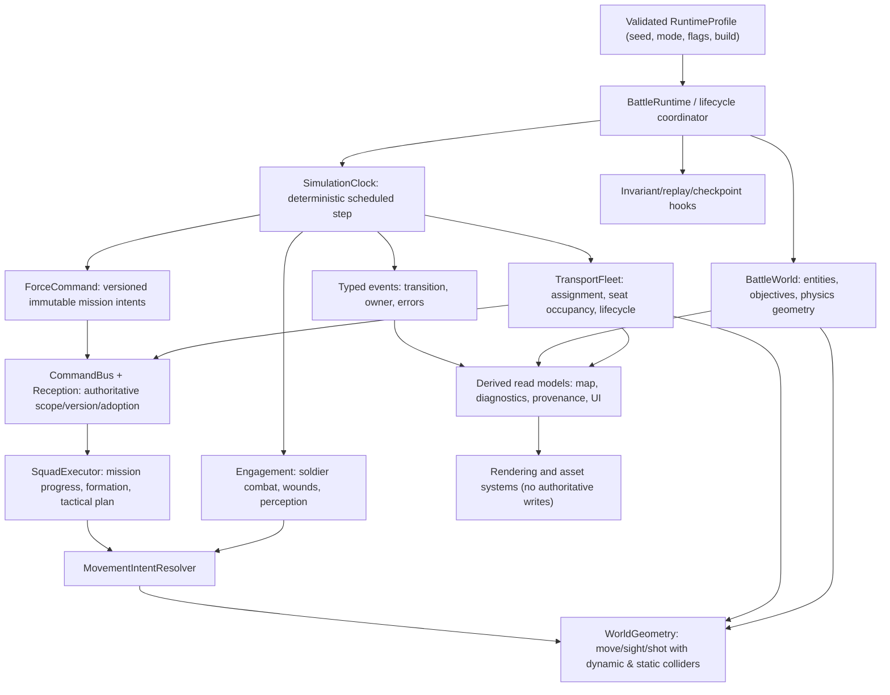

# Target architecture and incremental refactoring roadmap

**Source baseline:** `main@f89939f2f6e8ff21063d1b24c28a8ab73fe9d2e9`. **Status:** recommendations only; no gameplay mutations authorized/performed.

## The answer to the architecture question

**GRASSTEX has a viable simulation foundation, but significant accidental integration complexity has accumulated.** Some systems are correctly specialized: Macro supplies mission intent, Meso plans squads, Engagement controls micro behaviors, Movement Resolver arbitrates destinations, and rendering should observe physics. Yet key implementation boundaries are not enforced consistently. Several critical lifecycle transitions are monkey-patched through ordered wrappers; dynamic vehicle geometry depends on the physicality layer replacing several base navigation functions at load time; transport tracks vehicle and squad task state in parallel; and feature prerequisites are scattered across URL parsing and preview routing. This is an **incremental consolidation** candidate, not a greenfield rewrite candidate.

Correctness/safety and measurement must precede state-count or code-size reduction. Preserve working doctrine, historical and learned fixtures, existing benchmark artifacts, original commit/seed replay support, simulation-time behavior, visual fidelity and the absence of invisible enemy truth.

## Proposed architecture

The diagram names responsibilities, not a mandate to introduce eleven new classes or a framework. Reuse `BattleModules`, `BattleMovementResolver`, `BattleCommanderAI`, `BattleCommandReception` and `BattleSquadTransport` where already appropriate. Add the **least** new abstraction that removes several implicit coordination paths.

### Required invariants before any architecture PR

1. Every battle has a unique generation, an exact seed and one authoritative simulation time source; restart replaces generation-bound resources and invalidates old async callbacks.
2. Macro never reads hidden enemy transforms for recon/interception and never directly writes soldier physical destinations.
3. Personal orders are not acted on before authoritative receipt/adoption where required; stale command versions cannot supersede new missions.
4. Each truck has one assignment and each living occupant one seat; abort/death/restart always release or explicitly transition reservations; vehicle bodies never teleport to base after travel.
5. Actors are moved only through legal static/dynamic collision geometry; bullets and sight use the same shape snapshot with query-mode and height differences explicit.
6. Rendering, audio and telemetry cannot change the battle result when toggled; opt-in debug hooks may observe but cannot issue gameplay orders.
7. Victory, pause, manual end, timeout Continue and restart have explicit mutually compatible states; terminal frames cannot advance clandestinely.
8. All behavior-impacting timers use simulation time, replay is seeded, and benchmark instrumentation effects are measured.

## Five highest-value architecture changes

| Rank | Change | Why it removes accidental complexity | Required quantitative acceptance |
| --- | --- | --- | --- |
| **1** | **Single lifecycle and simulation scheduler** | Replaces ordered `BattleSim.start` and `sim.restart` wrapper stack and independent commander/render observers with deterministic ordered boot/step/teardown; define which failures stop startup. | All wrappers removed or formally constrained, hook order tests, same-page restart and 1×/4×/8× parity, zero stale observers, paired seed battle fidelity |
| **2** | **Unified authoritative static+dynamic geometry** | Formalizes the already working physicality override so movement, pathfinding, LOS and bullets have a directly testable common query contract rather than load-order-sensitive wrappers. | Zero through-vehicle movement/shot incidents in fixtures, same seed and physics mode reproducibility, collision-query p95 regression threshold |
| **3** | **TransportFleet transaction + canonical occupancy** | Makes reservation→boarding→drive→dismount/abort→release explicit; derives board count, truck read state and squad-facing status from one ledger, no competing seat flags. | Zero leaked reservations, zero orphan passengers after death/restart, bounded blocked-exit recovery, replay all current 10-seat fixtures |
| **4** | **Versioned command-intent contract from Macro through Meso to Micro** | Aligns mission/version, reception and personal movement adoption around explicit ownership; reduces reissued corrections and stale mission updates without collapsing real independent combat states. | No stale command adoption, preserved intelligence isolation, unchanged capture and tactical decisions in paired benchmark, fewer duplicate field writers/leases |
| **5** | **Single runtime profile and reliable evidence pipeline** | Consolidates feature flags across host/preview/bench; observer error reporting and typed event logs prevent falsely green QA and unnecessary global instrumentation. Enables performance work from trustworthy profiles. | Launcher/native flag parity, test that actual interception occurs in at least one viable fixture, observer neutrality, measured p95 CPU/render/heap with profiler overhead quantified |

**Performance-first code changes come only after rank 5 establishes representative measurements.** A universal rewrite would risk breaking countless working interdependencies and require new proof of simulation fidelity while yielding no measured speed advantage.

## Ranked migration sequence — small independent PRs

Each PR is a proposed future work item, **not opened or implemented by this audit**. Every gameplay-changing PR requires user authorization before beginning.

### A. Immediate correctness and safety

| Proposed PR | Scope | Risk / effort | Acceptance / evidence |
| --- | --- | --- | --- |
| **A1** Disable or authenticate policy/learning writes | `battle_policy.php`, `battle_learning.php`; retain explicit trainer admin path | Medium / Small | Forged-Origin requests cannot mutate policy; authorized requests still validate revision and schema; no deployments without approval |
| **A2** Preview effective-profile contract | `preview.php`, host flags, runtime profile tests | Low–Medium / Small | All required transport/recon/interception/collision flags propagated; missing dependencies reported, not silently disabled |
| **A3** Composed physicality/OBB geometry contract tests; corrective integration **only if a discrepancy is reproduced** | `battle-navigation.js`, `obstacle-field.js`, transport dynamic footprint, ballistic contract | High / Medium | Prove the installed `39` extension handles moving OBB, static vs dynamic queries, self-ignore door/seat exceptions, and replay. Do not change working geometry solely from inspection |
| **A4** Dismount liveness & death/abort invariants | Transport task disembarking state, exitSpaceFree, occupancy | Medium / Small–Medium | Deterministic permanently occupied exit resolves boundedly and safely; no seat/reservation leak |
| **A5** Fail-safe authoritative hook/ballistic diagnostics | Module registry criticality, ballistics error handling, diagnostic serialization | Medium / Small–Medium | Injected exceptions visible and classified; restart cannot silently half-initialize; no shots classified clear when geometry invalid |

### B. Structural simplification

| Proposed PR | Scope | Risk / effort | Acceptance / evidence |
| --- | --- | --- | --- |
| **B1** Lifecycle inventory/shadow invariants (instrumentation only) | start/restart observer registration ledger, per-generation resource owners | Low / Small | Exact event order trace; baseline parity even with probes enabled |
| **B2** Canonical battle boot/restart phases | Replace wrappers **one at a time** with ordered ownership hooks | High / Large split into ≥2 PRs | All old wrapper parity, mutation test that missing owner fails test, no startup/death/pause regressions |
| **B3** Transport reservation and seat transaction | canonical vehicle assignment map, derive redundant counts/status flags | High / Medium | strict many-squad and death/aborted lifecycle sequences |
| **B4** Single command ownership proof | map `_macroMission`, commandPhase, leases, personal envelope, movement endpoint writers; make explicit versioned handoffs | High / Medium–Large | unchanged mission choices and objective closures, reduce writer count, no hidden reads |
| **B5** Consolidate justified navigation fallbacks | only after blocked-step telemetry shows redundant mechanisms | Medium / Medium | no increase in wall penetration or stalls; compare nav calls/tick and destination closure |
| **B6** Normalize telemetry/provenance origin | emit ownership events when real owners commit; retire instrumented setter/wrapper layers only after replay validation | Medium / Medium | precise provenance retained, observer neutrality, measured overhead drop |

### C. Performance improvements — **conditional on profiling**

| Candidate PR | Trigger evidence required | Risk / effort | Performance gate |
| --- | --- | --- | --- |
| **C1** Spatial query optimization | measured dominant `movementClear`/obstacle cost at 5 km | Medium / Medium | reduced exclusive query time/p95 with identical obstruction answers |
| **C2** AI decision cadence optimization | measured excessive unchanged decision cycles, no contact reaction lag | High / Medium | lower decision CPU without lowered fire/control/intent fidelity |
| **C3** World-scans/allocations normalization | measured N² behavior or GC pressure; not just many loops by inspection | Medium / Medium | allocation and p95 reduction at 50/100/200 actors |
| **C4** FBX pose/draw/LOD improvements | real device/browser GPU profiling identifies rendering bottleneck | Medium / Medium | frame-time and memory improvement with visual parity |
| **C5** Diagnostics overhead reduction | measured provenance/telemetry cost across enabled/disabled profiles | Low–Medium / Small | overhead decrease and same source-event integrity |

**Do not prioritize C1–C5 based on code aesthetics or the one CI Chromium FPS sample.** The CI numbers in the validation report are only a single fixture, not comparative CPU profiling.

## Correctness → architecture → speed decision gates

1. **Stop unsafe mutations first:** close SEC-01 independent of simulation refactor. Keep server backup and permissions.
2. **Reproduce boundary violations:** physicality collision consistency under full module composition, blocked exit, launch flag loss, injected ballistics fault. Collect fixed seed and traces; avoid patching symptoms without invariant design.
3. **Instrument ownership/read models non-invasively:** ledger of who wrote each authoritative field and when. Confirm whether suspected double writes are actual disagreements.
4. **Demonstrate baseline and test blind spots:** get at least one *viable actual interception* in deterministic ON scenario with meaningful outcome assertions; preserve all negative controls.
5. **Prototype simplified slice behind controlled test implementation:** compare old/new on paired seeds with same command timeline, objective closure, casualties and geometry. Revert unless equivalent.
6. **Measure before optimization:** substep and render p50/p95/p99, heap, GC, draw calls and fixture profile. Accept faster only if no fidelity/determinism regression.
7. **Delete the legacy implementation only once behavioral and performance proof exists**; remove stale feature flags/wrappers and update documentation/CI together.

## Quantification scoreboard for follow-up PRs

No invented claimed savings. Maintain a machine-generated pre/post register of:
- Number of authoritative state writers per field and independent mirrors (`_transport` vs fleet, `commandPhase` vs plan, `winner` vs manual flags).
- Start/restart wrappers and before-render observers; count eliminated.
- Runtime configuration parameters/aliases and invalid combinations detected.
- State variants actually reachable in replay (not mere Cartesian products).
- Owner-to-owner runtime dependencies/cycles and forced loader-order edges.
- Dead compatibility branches demonstrated unused by execution coverage.
- Simulation step p95/p99, commander exclusive CPU, nav/ballistic query counts, heap at 0/15/30 min, GC time and rendering frame time.
- Deterministic replay mismatch count, mission outcome differences, objective progress, invalid exit/reservation transitions, and full CI time.

## Explicit no-go criteria

- Do not merge architectural simplifications that change casualty/capture outcomes without a reviewed explanation of why the old behavior was invalid.
- Do not conflate orthogonal combat, movement and mission state simply to lower an enum count.
- Do not eliminate line-of-sight, traction, stress, collision or strategic intelligence fidelity for better benchmark statistics.
- Do not touch historical benchmark artifacts, unrelated PRs or deployed files as part of an audit-only branch.
- Do not state that green CI closes a scenario it never positively exercises.
- Do not launch a large rewrite without a demonstrably lower-risk, lower-cost comparison against staged improvement.

## Decision summary

GRASSTEX is **not fundamentally unsound**, but the current coordination architecture is more fragile than its clean conceptual design. The greatest gains are likely to come from **one owner per lifecycle and resource, one geometry truth for physical interactions, and one explicit command/configuration contract**, validated by real replay and outcome-based tests. The current evidence justifies consolidation; it does not justify claiming performance gains or rewriting the simulator wholesale.

## Corrected physicality interpretation

The initial code review stopped at the static base implementation of `BattleNavigation.movementClear`; the subsequent cross-check found that `39-navigation-physicality-debug.js` replaces exported movement, route and waypoint APIs and **does** incorporate dynamic truck footprints and ignore-self semantics. The roadmap therefore treats a common geometry facade as **potential architectural simplification**, not as a necessary fix for a demonstrated through-truck collision defect. Before changing geometry, instrument the composed code and verify actual behavior and costs.
